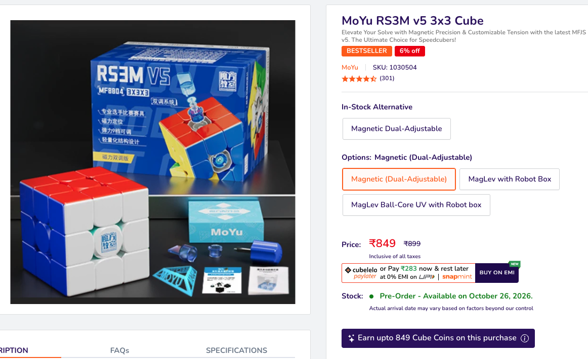
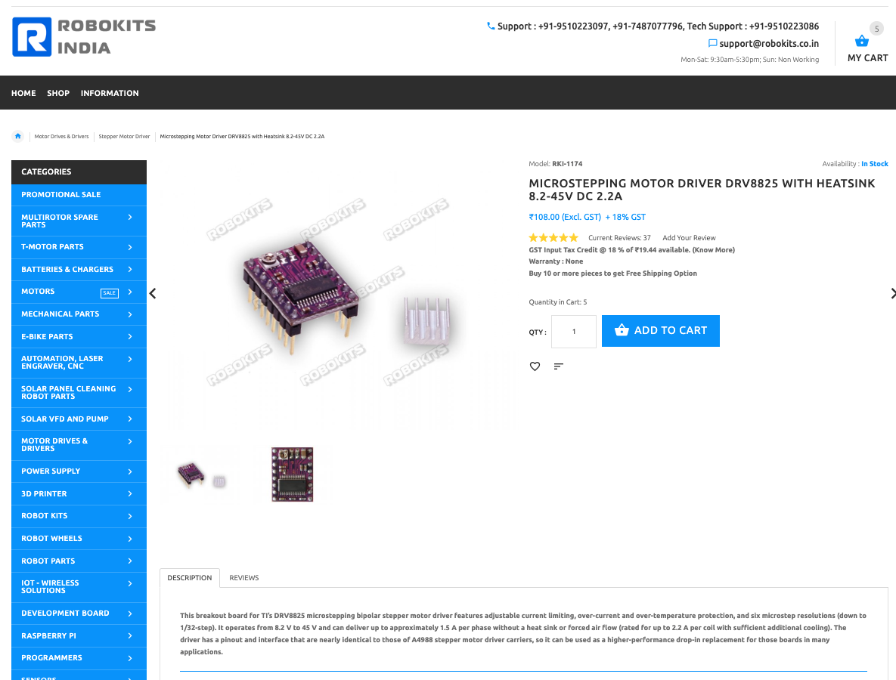
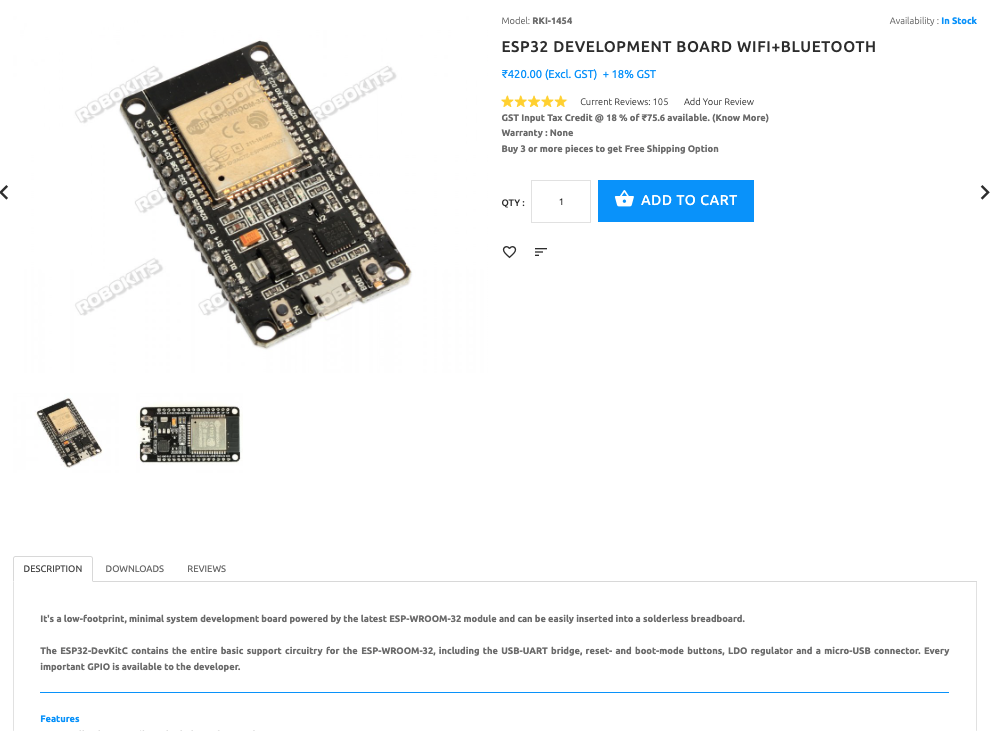
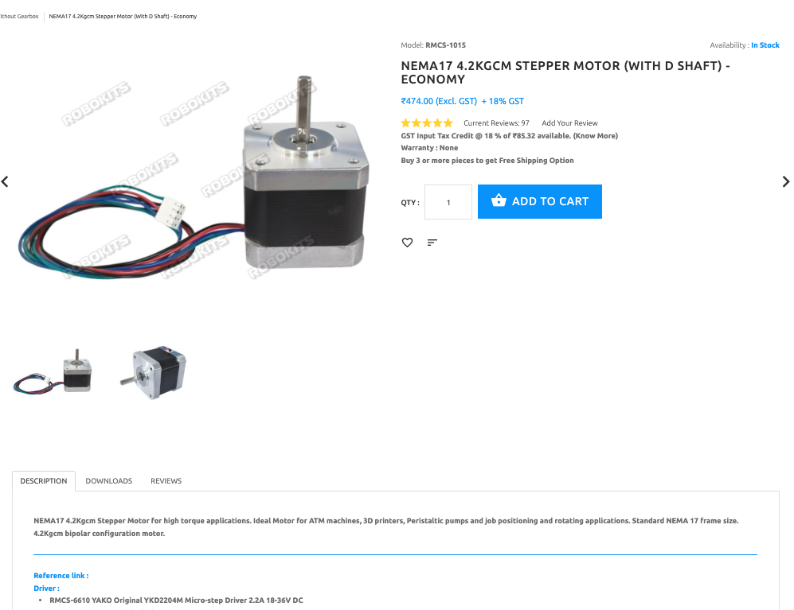
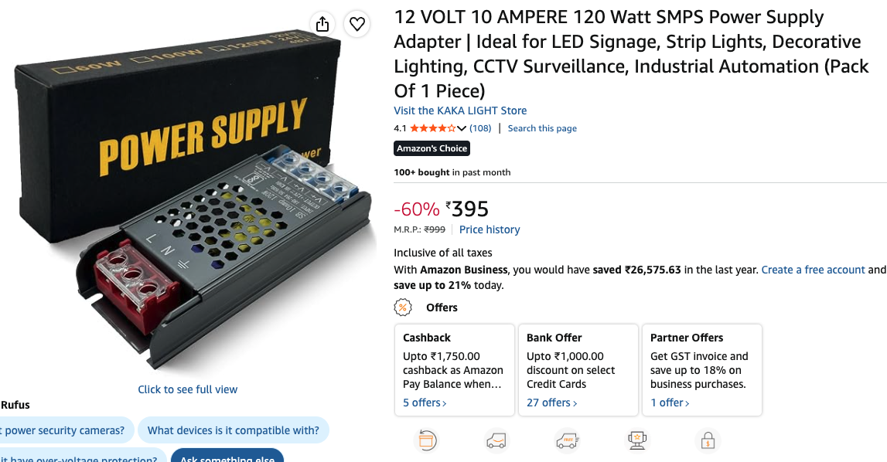

# cube-solving-from-image

Use python 3.11

commands:
```
python -m venv venv

pip install req.txt

python cube-solving.py
```

then follow the instructions on screen


## Components & Materials

| Product | Details | Image |
|---|---|---|
| [RS3M V5 3×3 Cube](https://www.cubelelo.com/products/rs3m-v5-3x3-cube-magnetic-dual-adjustment?variant=47710476173601) | Magnetic 3×3 speed cube with a dual-adjustment system. Used as the cube-solving target. | <a href="images/cube.png" target="_blank"></a> |
| [DRV8825 Stepper Motor Driver](https://robokits.co.in/motor-drives-drivers/stepper-motor-driver/microstepping-motor-driver-drv8825-with-heatsink-8.2-45v-dc-2.2a?products_id=629:051e4e127b92f5d98d3c79b195f2b291) | Microstepping driver for bipolar stepper motors. Supply voltage: 8.2–45 V DC; rated output current up to 2.2 A, subject to cooling and operating conditions. | <a href="images/drv8825.png" target="_blank"></a> |
| [ESP32 Development Board](https://robokits.co.in/wireless-solutions/iot-esp-module/esp32-development-board-wifi-bluetooth) | Microcontroller development board with Wi-Fi and Bluetooth. Handles communication and control logic. | <a href="images/esp32.png" target="_blank"></a> |
| [NEMA 17 Stepper Motor](https://robokits.co.in/motors/stepper-motor/stepper-motor-without-gearbox/nema17-4.2kgcm-stepper-motor-with-d-shaft-economy) | Bipolar stepper motor with a D-shaped shaft. Advertised holding torque: 4.2 kg·cm. Used to rotate the cube mechanism. | <a href="images/nema-17.png" target="_blank"></a> |
| 100 µF, 25 V Capacitors (20 pcs) | Polarized electrolytic capacitors rated at 100 µF and 25 V. Used for power-supply filtering and voltage stabilization where appropriate. | — |
| Digital Multimeter | Used to measure voltage, current, resistance, and check electrical connections during testing. | — |
| Jumper Wires | Used to connect the ESP32, motor drivers, and other electronic components. | — |
| Breadboard | Solderless prototyping board for assembling and testing circuits. | — |
| [12 V, 10 A Power Supply](https://www.amazon.in/dp/B0FV8J4NDJ?ref=ppx_yo2ov_dt_b_fed_asin_title) | Provides a 12 V DC supply with a maximum rated current of 10 A for the system. | <a href="images/power-supply.png" target="_blank"></a> |
| 3D-Printed Parts | Custom components used to mount the motors, and hold the cube. | <a href="3d printed parts/" target="_blank">STLs</a> |
